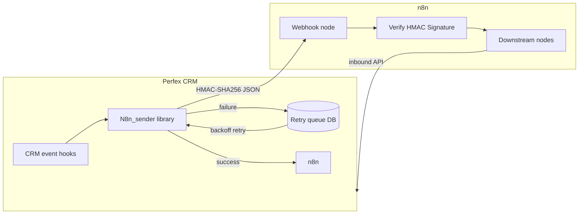

# Perfex n8n Bridge

**Version 2.1.0** — Bi-directional automation between [Perfex CRM](https://www.perfexcrm.com/) and [n8n](https://n8n.io/), delivered as a Perfex module.

## What / for whom

**What it is:** A Perfex CRM module that signs outbound webhooks, queues retries, and ships an importable n8n workflow with HMAC verification.

**Who it is for:** Agencies and freelancers who run Perfex as the CRM of record and want reliable n8n automations without losing events during outages.

- **What:** A Perfex CRM module that sends signed webhooks to n8n, accepts inbound updates, and retries delivery when n8n is temporarily unavailable.
- **For:** Agencies and freelancers who run Perfex as the CRM of record and want reliable n8n automations without losing events during outages.
- **Not for:** Teams that only need an n8n community node calling Perfex API — use `n8n-nodes-perfexcrm` (MIT) in that case. This project installs **inside Perfex** and pushes **out** to n8n.

Packaged distribution (module zip, blueprint, offline docs): [Perfex n8n Bridge on Gumroad](https://soluradev.gumroad.com/l/perfex-n8n-bridge)

## Demo

- **Product page:** https://soluradev.gumroad.com/l/perfex-n8n-bridge
- **Local verification:** `make verify` (no Perfex or n8n instance required for the regression suite)

## Quick start

1. Copy `n8n_bridge/` into your Perfex `modules/` directory.
2. In Perfex admin: **Setup → Modules** → activate **N8N Bridge**.
3. Open **Setup → N8N Bridge**, paste your n8n webhook URL, run **Test Connection**.
4. Import `n8n_blueprint.json` into n8n (optional starter workflow with HMAC verification).

**Verify before deploy:**

```bash
make verify
```

## Architecture



## Decisions / tradeoffs

| Decision | Rationale | Tradeoff |
|----------|-----------|----------|
| Module inside Perfex (not n8n node) | Captures CRM lifecycle events at source; owns retry queue | Buyers must install PHP module on Perfex host |
| DB-backed queue + exponential backoff | Survives n8n downtime (5m → 12h ladder) | Requires Perfex cron; not instant at extreme delay |
| HMAC on raw JSON body | Matches n8n verification node in blueprint | Webhook node must enable **Raw Body** in n8n |
| Duplicate detection in workflow static data | Stops queue retries from double-processing | Not a substitute for Redis/`SETNX` under race attacks |
| Local test harness executes blueprint node code | Tests what you import, not a forked mock | Node.js required for JS suite; PHP for sender tests |

## Tests

| Command | What it checks |
|---------|----------------|
| `node tests/verify-node.test.js` | 18 cases against the live `Verify HMAC Signature` code in `n8n_blueprint.json` |
| `php tests/sender-hmac.test.php` | Sender HMAC signing, routing, and queue behavior without network |
| `make verify` | Runs both suites plus PHP syntax lint |

## System requirements

- Perfex CRM 2.3.0+
- PHP 7.4+ (8.x recommended), cURL
- MySQL 5.7+ / MariaDB 10.2+

## Repository layout

```text
n8n_bridge/          # Perfex module (controllers, models, views, N8n_sender)
n8n_blueprint.json   # Importable n8n workflow with HMAC verification
Documentation/       # Offline HTML documentation
tests/               # Node + PHP regression suites
ci/                  # Optional real-n8n e2e script (not required for make verify)
```

## License

MIT — see [LICENSE](LICENSE). Gumroad package terms apply to the commercial bundle; this repository is the open reference implementation and test harness.
